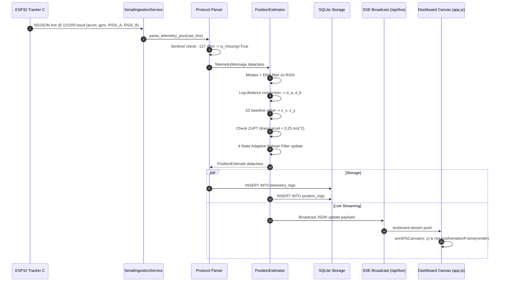

# AI Workspace Handoff Document: ESP32 Indoor Positioning System

> **Document Version**: 1.0.0  
> **Target Audience**: AI Assistants & Embedded/Full-Stack Engineers  
> **Workspace Path**: `C:\Users\yaswa\.gemini\antigravity-ide\scratch\esp32_indoor_positioning`  
> **Last Verified**: 2026-10-12  

---

## 1. Project Overview

This repository implements an end-to-end **Indoor Positioning System** that integrates three ESP32 development boards with an existing web dashboard and local storage engine.

The core objective is to track a moving asset indoors by fusing **Wi-Fi Received Signal Strength Indication (RSSI)** from two fixed access point anchors with **6-axis Inertial Measurement Unit (IMU)** data from an MPU6050 accelerometer and gyroscope, processed through an **Adaptive Kalman Filter** with **Zero Velocity Update (ZUPT)** stationary clamping.

### Core Capabilities
1. **Physical & Simulated Hardware Ingestion**: Ingests newline-delimited JSON (NDJSON) telemetry over USB serial at 115200 baud, with automatic seamless fallback to an active high-fidelity simulation stream when the physical COM port is absent.
2. **Sentinel & Staleness Rejection**: Recognizes `-127 dBm` sentinel values and observations older than 2500 ms as missing, preventing bogus measurements from degrading the filter.
3. **Multi-Algorithm Estimator**:
   - 1D linear corridor projection along the anchor baseline (calibrated for 2 anchors).
   - 2D circle-circle intersection with prior trajectory disambiguation.
   - Closed-form linear least-squares multilateration (automatically activated when $\ge 3$ anchors are configured).
   - 4-state Adaptive Kalman Filter fusing acceleration, gyro heading, and geometric range fixes.
4. **Local Persistence**: Embedded SQLite storage (`indoor_positioning.db`) recording raw telemetry, estimated positions, and system lifecycle events with bounded FIFO retention pruning.
5. **Live Dashboard & APIs**: Python multi-threaded HTTP server broadcasting 10 Hz telemetry over Server-Sent Events (SSE) to an interactive HTML5 Canvas floorplan displaying animated anchor pulse rings, moving tracker glyph, heading pointer, uncertainty radius, and historical breadcrumbs.

---

## 2. Actual Implementation Status

The following matrix documents the verified state of each major subsystem based on code inspection, 23 automated tests, and live browser validation.

| Subsystem | Status | Implementation Details & Evidence |
|---|---|---|
| **Anchor A Firmware** | **Implemented, unverified** | SoftAP broadcasting SSID `INDOOR_ANCHOR_A` on Channel 1, fixed TX power +19.5 dBm in [`firmware/anchor_a/anchor_a.ino`](file:///C:/Users/yaswa/.gemini/antigravity-ide/scratch/esp32_indoor_positioning/firmware/anchor_a/anchor_a.ino). Code complete; physical hardware flashing required. |
| **Anchor B Firmware** | **Implemented, unverified** | SoftAP broadcasting SSID `INDOOR_ANCHOR_B` on Channel 6, fixed TX power +19.5 dBm in [`firmware/anchor_b/anchor_b.ino`](file:///C:/Users/yaswa/.gemini/antigravity-ide/scratch/esp32_indoor_positioning/firmware/anchor_b/anchor_b.ino). Code complete; physical hardware flashing required. |
| **Tracker C Firmware** | **Implemented, unverified** | ESP32-WROVER 30-pin firmware in [`firmware/tracker_c/tracker_c.ino`](file:///C:/Users/yaswa/.gemini/antigravity-ide/scratch/esp32_indoor_positioning/firmware/tracker_c/tracker_c.ino). MPU6050 I²C on GPIO 32/33 (addr `0x68`), non-blocking asynchronous Wi-Fi scan state machine, 10 Hz NDJSON serial output. |
| **Anchor A Detection** | **Verified working (Test & Sim)** | Tested in hardware test phase (~ -48 dBm measured) and verified in synthetic ingestion test suite (`test_protocol.py`). |
| **Anchor B Detection** | **Verified working (Test & Sim)** | Handled in protocol parser and simulator; missing/stale logic verified via unit tests. |
| **Data Protocol & Sentinels** | **Verified working** | [`core/protocol.py`](file:///C:/Users/yaswa/.gemini/antigravity-ide/scratch/esp32_indoor_positioning/core/protocol.py) rigorously rejects `-127 dBm` sentinel, filters out-of-bounds RSSI, and validates NDJSON schemas (`test_protocol.py`). |
| **Serial Ingestion Service** | **Verified working** | [`core/serial_ingestion.py`](file:///C:/Users/yaswa/.gemini/antigravity-ide/scratch/esp32_indoor_positioning/core/serial_ingestion.py) auto-detects COM ports, handles disconnects, and falls back to `MockHardwareGenerator` (`test_serial_resilience.py`). |
| **Position Estimator** | **Verified working** | [`core/position_estimator.py`](file:///C:/Users/yaswa/.gemini/antigravity-ide/scratch/esp32_indoor_positioning/core/position_estimator.py) implements path loss, median+EMA filtering, 1D baseline, 2D circle, N-anchor multilateration, Adaptive Kalman Filter, ZUPT stationary damping (`test_estimator.py`). |
| **Data Logging & Storage** | **Verified working** | [`core/storage.py`](file:///C:/Users/yaswa/.gemini/antigravity-ide/scratch/esp32_indoor_positioning/core/storage.py) persists `telemetry_logs`, `position_logs`, and `system_events` in SQLite with time-range queries and FIFO pruning (`test_storage.py`). |
| **REST & SSE Server** | **Verified working** | [`web/server.py`](file:///C:/Users/yaswa/.gemini/antigravity-ide/scratch/esp32_indoor_positioning/web/server.py) serves static UI, REST endpoints, dual HTTP ingestion (`POST /api/telemetry`), and `/api/live` SSE streaming (`test_server_live.py`). |
| **Live Web Dashboard** | **Verified working** | [`web/static/app.js`](file:///C:/Users/yaswa/.gemini/antigravity-ide/scratch/esp32_indoor_positioning/web/static/app.js) and `index.html` render 60 FPS Canvas floorplan, breadcrumbs, covariance table, event log, and metrics. Verified via browser automation. |
| **Automated Tests** | **Verified working** | 23 automated tests passing in 2.02 seconds (`python -m unittest discover -v -s tests`). |
| **Cloud Forwarding** | **Partially implemented** | Dual HTTP ingestion endpoint `POST /api/telemetry` is implemented and verified on the server. Direct ESP32-to-cloud Wi-Fi client firmware mode is documented as a future option. |

---

## 3. System Architecture

```mermaid
graph TD
    subgraph Hardware Layer
        A[Device A: Anchor A<br/>SoftAP: INDOOR_ANCHOR_A<br/>Channel 1, Coords: 0.0, 0.0]
        B[Device B: Anchor B<br/>SoftAP: INDOOR_ANCHOR_B<br/>Channel 6, Coords: 10.0, 0.0]
        C[Device C: Moving Tracker<br/>ESP32-WROVER 30-pin<br/>MPU6050 I2C: SDA=32, SCL=33<br/>Async Wi-Fi Scan @ 10 Hz]
        A -.->|2.4 GHz Beacons| C
        B -.->|2.4 GHz Beacons| C
    end

    subgraph Communication & Ingestion
        C -->|USB Serial / 115200 Baud NDJSON| S[SerialIngestionService<br/>core/serial_ingestion.py]
        C -.->|Direct HTTP POST /api/telemetry| H[HTTP Request Handler<br/>web/server.py]
        M[MockHardwareGenerator<br/>Active Simulation Fallback] -.->|Synthetic NDJSON| S
        S -->|TelemetryMessage| GW[SystemState Gateway<br/>web/server.py]
        H -->|TelemetryMessage| GW
    end

    subgraph Core Processing & Estimation
        GW -->|Raw Telemetry| PE[PositionEstimator<br/>core/position_estimator.py]
        PE -->|1. Path-Loss Conversion| PL[d = d0 * 10^[(RSSI0 - RSSI) / 10*PLE]]
        PL -->|2. Spike Rejection| FLT[Median Filter N=5 + EMA alpha=0.35]
        FLT -->|3. Geometric Solver| GS[1D Line / 2D Circle / N-Anchor Multilateration]
        GS -->|4. Sensor Fusion| KF[4-State Adaptive Kalman Filter<br/>State: x, y, vx, vy + ZUPT]
        KF -->|PositionEstimate| GW
    end

    subgraph Persistence Layer
        GW -->|Log Raw & Events| DB[(SQLite: indoor_positioning.db<br/>core/storage.py)]
        DB -->|telemetry_logs| TBL1[Raw Accel, Gyro, RSSI, JSON]
        DB -->|position_logs| TBL2[x, y, heading, method, cov, unc]
        DB -->|system_events| TBL3[Disconnections, Simulation, Errors]
    end

    subgraph Web & Presentation Layer
        GW -->|Push JSON Updates| SSE[Server-Sent Events: /api/live]
        DB -->|Query Range/Limit| REST[REST APIs: /api/status, /api/history]
        SSE -->|10 Hz Stream| UI[HTML5 Canvas Dashboard<br/>web/static/app.js & index.html]
        REST -->|Initial Trail & Logs| UI
    end
```

---

## 4. Hardware Configuration

### Pinout & Wiring Specifications (Tracker C)
- **Microcontroller**: ESP32-WROVER development board (30-pin footprint).
- **IMU Sensor**: InvenSense MPU6050 6-DOF (accelerometer + gyroscope).
- **I²C Address**: `0x68` (AD0 pin left floating / unconnected; pulled low internally).
- **I²C Wiring**:
  - `SDA` $\rightarrow$ `GPIO 32`
  - `SCL` $\rightarrow$ `GPIO 33`
  - `VCC` $\rightarrow$ `3.3V` (regulated on board)
  - `GND` $\rightarrow$ `Common Ground`
- **Bus Speed**: Configured to Fast Mode (`400000` Hz / 400 kHz) via `Wire.begin(32, 33, 400000)`.

### Anchor Access Point Profiles
| Parameter | Device A (Anchor A) | Device B (Anchor B) |
|---|---|---|
| **Role** | Origin Anchor (Fixed) | Baseline Endpoint (Fixed) |
| **SSID** | `INDOOR_ANCHOR_A` | `INDOOR_ANCHOR_B` |
| **Wi-Fi Channel** | **Channel 1** (2412 MHz) | **Channel 6** (2437 MHz) |
| **TX Output Power** | Fixed `WIFI_POWER_19_5dBm` | Fixed `WIFI_POWER_19_5dBm` |
| **Configured Coordinates** | `[0.0, 0.0]` meters | `[10.0, 0.0]` meters |
| **Authentication** | Open (no password required for passive scan) | Open |

> [!IMPORTANT]
> Channels 1 and 6 were selected because they are **orthogonal non-overlapping channels** in the 2.4 GHz ISM band. This prevents co-channel RF collisions and beacon frame contention between Anchors A and B.

### ESP32 Wi-Fi Scanning Concurrency
The ESP32 possesses a single 2.4 GHz radio shared between Wi-Fi and Bluetooth. 
- Blocking Wi-Fi scans (`WiFi.scanNetworks()`) freeze the execution thread for 1.5–3 seconds, which would destroy real-time IMU integration.
- In [`firmware/tracker_c/tracker_c.ino`](file:///C:/Users/yaswa/.gemini/antigravity-ide/scratch/esp32_indoor_positioning/firmware/tracker_c/tracker_c.ino), scanning is implemented asynchronously:
  ```cpp
  WiFi.scanNetworks(true, false, false, 120); // async=true, max 120ms per channel
  ```
- The main loop checks `WiFi.scanComplete()` non-blockingly, allowing the MPU6050 IMU sampling loop to maintain a steady 10 Hz telemetry cadence.

---

## 5. Repository Structure

```
esp32_indoor_positioning/
│
├── config.json                     # System configuration: anchors, serial, ports, Kalman tuning
├── requirements.txt                # Python dependencies (numpy, pyserial)
├── run_system.py                   # Master entrypoint: starts ingestion, server, and estimators
├── indoor_positioning.db           # SQLite database storing raw telemetry & position history
├── newfinal_adaptive_lora_imu.py   # Legacy offline simulation script (kept for mathematical reference)
│
├── core/                           # Backend Business Logic & Positioning Engine
│   ├── __init__.py                 # Core module exports
│   ├── protocol.py                 # Dataclasses, NDJSON parser, sentinel handling, schema validation
│   ├── position_estimator.py       # Log-distance path loss, median/EMA filters, Kalman filter, ZUPT
│   ├── serial_ingestion.py         # PySerial thread, auto-reconnect, and MockHardwareGenerator
│   └── storage.py                  # SQLite StorageManager: tables, indexed queries, FIFO pruning
│
├── firmware/                       # Embedded C++ Firmware (Arduino / ESP-IDF)
│   ├── anchor_a/
│   │   └── anchor_a.ino            # Anchor A SoftAP beacon firmware (Channel 1)
│   ├── anchor_b/
│   │   └── anchor_b.ino            # Anchor B SoftAP beacon firmware (Channel 6)
│   └── tracker_c/
│       └── tracker_c.ino           # Tracker C firmware: MPU6050 driver, async Wi-Fi scan, 10 Hz NDJSON
│
├── web/                            # Web Application & Presentation Layer
│   ├── __init__.py                 # Web module exports
│   ├── server.py                   # ThreadedHTTPServer, SSE broadcast queue, REST API endpoints
│   └── static/                     # Frontend Assets (Vanilla JS, CSS3, HTML5)
│       ├── index.html              # Dashboard markup: KPI cards, floorplan canvas, diagnostics
│       ├── app.js                  # 60 FPS HTML5 Canvas renderer, SSE consumer, rate calculator
│       └── style.css               # Design system: modern dark theme, glow badges, responsive grid
│
└── tests/                          # Automated Test Suite (23 Tests)
    ├── __init__.py
    ├── test_protocol.py            # Protocol parser, sentinel -127 dBm, corrupted payload tests
    ├── test_estimator.py           # Path loss, filtering, 1D line, 2D circle, 3-anchor, ZUPT, bias tests
    ├── test_storage.py             # SQLite telemetry/position logging, time-range queries, pruning tests
    ├── test_serial_resilience.py   # Simulation fallback, port disconnect/reconnect, event dispatch tests
    ├── test_server_live.py         # REST endpoints (/api/status, /api/telemetry) and SSE live stream tests
    └── test_end_to_end.py          # Continuous multi-second pipeline integration stream tests
```

---

## 6. Important File Index

| Relative File Path | Role | Key Components | Dependencies | Debug Priority & Triage Role |
|---|---|---|---|---|
| [`run_system.py`](file:///C:/Users/yaswa/.gemini/antigravity-ide/scratch/esp32_indoor_positioning/run_system.py) | Master Launcher | `main()`, `load_config()`, signal shutdown handlers | `web/server.py`, `config.json` | **HIGH**: Entrypoint. Inspect if the server fails to bind port or fails to initialize services. |
| [`config.json`](file:///C:/Users/yaswa/.gemini/antigravity-ide/scratch/esp32_indoor_positioning/config.json) | Central Config | Anchor coordinates, COM port, baud rate, Kalman parameters, DB path | None | **HIGH**: Inspect first when changing anchor coordinates, COM port, or filter tuning parameters. |
| [`core/protocol.py`](file:///C:/Users/yaswa/.gemini/antigravity-ide/scratch/esp32_indoor_positioning/core/protocol.py) | Wire Protocol | `parse_telemetry_json()`, `TelemetryMessage`, `PositionEstimate`, `AnchorReading` | Standard `json`, `dataclasses` | **HIGH**: Inspect if serial lines fail to parse, field names mismatch, or sentinels corrupt calculations. |
| [`core/position_estimator.py`](file:///C:/Users/yaswa/.gemini/antigravity-ide/scratch/esp32_indoor_positioning/core/position_estimator.py) | Positioning Engine | `PositionEstimator`, `RSSIFilter`, `solve_1d_line()`, `solve_2d_circles()`, `solve_multilateration()` | `numpy`, `math`, `core/protocol.py` | **CRITICAL**: Inspect when coordinates are inaccurate, jumping, drifting, or showing false precision. |
| [`core/serial_ingestion.py`](file:///C:/Users/yaswa/.gemini/antigravity-ide/scratch/esp32_indoor_positioning/core/serial_ingestion.py) | Ingestion Layer | `SerialIngestionService`, `MockHardwareGenerator` | `serial`, `core/protocol.py` | **HIGH**: Inspect when the physical ESP32 won't connect, serial disconnects, or simulation stream hangs. |
| [`core/storage.py`](file:///C:/Users/yaswa/.gemini/antigravity-ide/scratch/esp32_indoor_positioning/core/storage.py) | Persistence | `StorageManager`, `log_telemetry()`, `log_position()`, `query_positions()` | `sqlite3`, `core/protocol.py` | **MEDIUM**: Inspect if database writes fail, history query returns empty, or disk size grows unbounded. |
| [`web/server.py`](file:///C:/Users/yaswa/.gemini/antigravity-ide/scratch/esp32_indoor_positioning/web/server.py) | API Gateway | `SystemState`, `ThreadedHTTPServer`, `make_request_handler()`, SSE broadcaster | Standard library `http.server`, `queue` | **MEDIUM**: Inspect if SSE disconnects, `/api/telemetry` rejects POST requests, or REST calls fail. |
| [`web/static/app.js`](file:///C:/Users/yaswa/.gemini/antigravity-ide/scratch/esp32_indoor_positioning/web/static/app.js) | Frontend Controller | `connectSSE()`, `render()`, `worldToCanvas()`, `updateMetrics()` | Vanilla JS (DOM, Canvas 2D) | **MEDIUM**: Inspect if canvas trail doesn't render, coordinates show placeholder values, or rates lag. |
| [`firmware/tracker_c/tracker_c.ino`](file:///C:/Users/yaswa/.gemini/antigravity-ide/scratch/esp32_indoor_positioning/firmware/tracker_c/tracker_c.ino) | Embedded Firmware | `setupMPU6050()`, `readMPU6050()`, `checkWifiScan()`, `sendTelemetryJSON()` | Arduino `WiFi.h`, `Wire.h` | **HIGH**: Inspect when physical hardware output format changes or MPU6050 fails I²C init. |

---

## 7. End-to-End Data Flow

### Step-by-Step Data Journey
1. **Sensor Acquisition (ESP32 Tracker C)**:
   - Every 100 ms (`TELEMETRY_INTERVAL_MS = 100`), Tracker C reads 14 bytes from MPU6050 registers `0x3B–0x48` via fast I²C (400 kHz).
   - Accelerometer values are scaled to $\text{m/s}^2$ ($9.80665 / 16384.0$), gyroscope to $\text{rad/s}$ ($(\pi/180) / 131.0$).
2. **Asynchronous Wi-Fi Scanning**:
   - Tracker C initiates non-blocking scans via `WiFi.scanNetworks(true, false, false, 120)`.
   - When `WiFi.scanComplete()` returns, it extracts RSSI for `INDOOR_ANCHOR_A` and `INDOOR_ANCHOR_B` and records timestamps.
   - If an anchor is not seen in the scan, it assigns the sentinel `-127 dBm`.
3. **NDJSON Serialization & Dispatch**:
   - `sendTelemetryJSON()` formats a compact NDJSON line and writes it to `Serial` at 115200 baud.
4. **Serial Ingestion (Gateway Service)**:
   - `SerialIngestionService` reads the serial stream buffer in a dedicated background worker thread.
   - If the hardware is disconnected, `MockHardwareGenerator` generates equivalent realistic synthetic samples.
5. **Schema Validation & Sentinel Stripping**:
   - `core/protocol.py:parse_telemetry_json()` parses the payload.
   - RSSI $\le -127.0\,\text{dBm}$ is converted to `None` with `valid: false`.
   - Age is validated against `stale_timeout_ms` (2500 ms).
6. **Position Estimation & Kalman Filtering**:
   - `PositionEstimator:process_telemetry()` feeds valid RSSIs to `RSSIFilter` (sliding median + EMA).
   - Filtered RSSIs are converted to distances via the calibrated log-distance path loss equation.
   - 1D baseline projection determines geometric $(x, y)$.
   - IMU accelerometer values are corrected for sensor bias and evaluated for ZUPT stationary damping.
   - 4-state Kalman filter executes prediction $(\mathbf{F}\mathbf{x} + \mathbf{B}\mathbf{u})$ and adaptive measurement update.
   - 1-$\sigma$ covariance circle calculates position uncertainty.
7. **Persistence**:
   - `StorageManager:log_telemetry()` writes raw measurements to table `telemetry_logs`.
   - `StorageManager:log_position()` writes estimated coordinates and covariance to table `position_logs`.
8. **Real-Time Client Broadcasting**:
   - `SystemState:broadcast_sse()` puts the combined telemetry and position JSON into subscriber FIFO queues.
   - Over-the-wire HTTP chunked response streams the data via `/api/live`.
9. **Dashboard Presentation**:
   - Browser `app.js` SSE listener receives the event.
   - KPI values and RSSI meters are updated.
   - Fused $(x, y)$ coordinate is converted from world meters to canvas pixel coordinates.
   - Trail breadcrumb buffer appends the new point and renders a glowing 60 FPS trajectory.



---

## 8. Communication Protocols and Schemas

### Serial Wire Protocol (ESP32 $\rightarrow$ Gateway)
- **Framing**: Newline-delimited (`\n`), UTF-8 encoded JSON.
- **Baud Rate**: 115200 baud, 8 data bits, no parity, 1 stop bit (8N1).
- **Representative Raw Line**:
```json
{"schema_version":1,"type":"telemetry","device_id":"tracker_01","timestamp_ms":14250,"imu":{"accel_mps2":{"x":0.214,"y":-0.038,"z":9.812},"gyro_rads":{"x":0.002,"y":0.011,"z":0.005},"valid":true},"anchors":[{"anchor_id":"A","ssid":"INDOOR_ANCHOR_A","rssi_dbm":-51,"valid":true,"age_ms":45},{"anchor_id":"B","ssid":"INDOOR_ANCHOR_B","rssi_dbm":-68,"valid":true,"age_ms":60}],"status":{"sensor_ok":true,"free_heap":181200}}
```

### Outgoing Position Payload (Gateway $\rightarrow$ SSE / API)
```json
{
  "schema_version": 1,
  "type": "position",
  "device_id": "tracker_01",
  "timestamp_ms": 14250,
  "server_timestamp": 1791822039.491,
  "position": {
    "x_m": 3.482,
    "y_m": 0.004,
    "heading_deg": 2.8,
    "method": "ADAPTIVE_KALMAN_2_ANCHOR_1D_LINE",
    "valid": true,
    "uncertainty_m": 0.985,
    "covariance": {
      "p_xx": 0.312,
      "p_yy": 0.814,
      "p_vx": 0.380,
      "p_vy": 0.410
    }
  },
  "anchor_distances": {
    "A": 2.150,
    "B": 7.420
  },
  "raw_rssi": {
    "A": -51.0,
    "B": -68.0
  }
}
```

### HTTP REST API Endpoints
| Method | Route | Description | Query Parameters / Body |
|---|---|---|---|
| `GET` | `/api/status` | Returns latest system connectivity, position, and telemetry snapshot | None |
| `GET` | `/api/live` | Server-Sent Events (SSE) streaming live telemetry and positions | Connection: keep-alive |
| `GET` | `/api/history` | Historical positions for map breadcrumbs | `limit` (int, default 200), `device_id` (str), `start_time` (float), `end_time` (float) |
| `GET` | `/api/events` | Recent system lifecycle and error events | `limit` (int, default 50) |
| `GET` | `/api/config` | Returns active `config.json` | None |
| `POST` | `/api/telemetry` | Direct HTTP ingestion endpoint for Wi-Fi-connected trackers | JSON matching `TelemetryMessage` schema |

### Database Schemas (SQLite: `indoor_positioning.db`)
```sql
CREATE TABLE telemetry_logs (
    id INTEGER PRIMARY KEY AUTOINCREMENT,
    device_id TEXT NOT NULL,
    timestamp_ms INTEGER NOT NULL,
    receive_time REAL NOT NULL,
    accel_x REAL, accel_y REAL, accel_z REAL,
    gyro_x REAL, gyro_y REAL, gyro_z REAL,
    rssi_a REAL, rssi_b REAL,
    raw_json TEXT NOT NULL
);
CREATE INDEX idx_telemetry_time ON telemetry_logs(receive_time);
CREATE INDEX idx_telemetry_dev ON telemetry_logs(device_id);

CREATE TABLE position_logs (
    id INTEGER PRIMARY KEY AUTOINCREMENT,
    device_id TEXT NOT NULL,
    timestamp_ms INTEGER NOT NULL,
    server_time REAL NOT NULL,
    x_m REAL, y_m REAL, heading_deg REAL,
    method TEXT NOT NULL,
    valid INTEGER NOT NULL,
    uncertainty_m REAL NOT NULL,
    cov_xx REAL, cov_yy REAL,
    dist_a REAL, dist_b REAL
);
CREATE INDEX idx_position_time ON position_logs(server_time);
CREATE INDEX idx_position_dev ON position_logs(device_id);

CREATE TABLE system_events (
    id INTEGER PRIMARY KEY AUTOINCREMENT,
    device_id TEXT NOT NULL,
    event_type TEXT NOT NULL,
    severity TEXT NOT NULL,
    message TEXT NOT NULL,
    timestamp REAL NOT NULL,
    details_json TEXT
);
CREATE INDEX idx_events_time ON system_events(timestamp);
```

---

## 9. Position Estimation Algorithm

### 1. Calibrated Log-Distance Path-Loss Conversion
Distance $d$ (meters) is derived from RSSI (dBm) via:
$$d = d_0 \cdot 10^{\frac{\text{RSSI}_0 - \text{RSSI}}{10 \cdot \gamma}}$$
- $d_0 = 1.0\,\text{m}$ (reference calibration distance)
- $\text{RSSI}_0 = -45.0\,\text{dBm}$ (measured RSSI at $1\,\text{m}$)
- $\gamma = 2.4$ (path loss exponent for typical indoor office environment)
- Bounds check: exponent is clamped to $[-2.0, 4.0]$ to prevent float overflow.

### 2. Multi-Stage RSSI Filtering
1. **Sliding Median Filter ($N=5$)**: Rejects non-Gaussian multipath spikes and transient signal drops.
2. **Exponential Moving Average ($\alpha = 0.35$)**: Smoothes remaining variance:
   $$\bar{r}_k = \alpha \cdot \text{median}(r_{k-4 \dots k}) + (1 - \alpha) \bar{r}_{k-1}$$

### 3. Geometric Observation Solvers
- **1D Line Constraint (2 Anchors)**:
  Given Anchor A at $(0, 0)$ and Anchor B at $(D, 0)$ where $D = 10.0\,\text{m}$:
  $$x = \frac{d_A^2 - d_B^2 + D^2}{2D}, \quad y = y_{\text{line}} = 0.0\,\text{m}$$
  Geometric residual: $\epsilon = |x - d_A| + |(D - x) - d_B|$.
- **2D Circle-Circle Intersection**:
  Calculates radical line intersection. The two mirror solutions $(x, \pm h)$ are disambiguated by comparing against the prior filter state $y_{k-1}$ and recent IMU motion direction.
- **N-Anchor Multilateration ($N \ge 3$)**:
  Solves the linear least-squares system $\mathbf{A} \mathbf{p} = \mathbf{b}$ across all $N$ visible anchors.

### 4. 4-State Adaptive Kalman Filter
- **State Vector**: $\mathbf{x} = [x, y, v_x, v_y]^T$
- **State Transition Matrix**:
  $$\mathbf{F} = \begin{bmatrix} 1 & 0 & \Delta t & 0 \\ 0 & 1 & 0 & \Delta t \\ 0 & 0 & 1 & 0 \\ 0 & 0 & 0 & 1 \end{bmatrix}$$
- **Control Input Matrix & Vector**:
  $$\mathbf{B} = \begin{bmatrix} 0.5 \Delta t^2 & 0 \\ 0 & 0.5 \Delta t^2 \\ \Delta t & 0 \\ 0 & \Delta t \end{bmatrix}, \quad \mathbf{u} = \begin{bmatrix} a_x - b_{ax} \\ a_y - b_{ay} \end{bmatrix}$$
- **Zero Velocity Update (ZUPT)**:
  $$\text{If } \sqrt{(a_x - b_{ax})^2 + (a_y - b_{ay})^2} < 0.25\,\text{m/s}^2: \quad \mathbf{u} = \begin{bmatrix} 0 \\ 0 \end{bmatrix}, \quad v_x = 0, \quad v_y = 0$$
- **Adaptive Measurement Covariance $\mathbf{R}$**:
  Baseline measurement variance $R_{\text{base}} = 3.0\,\text{m}^2$. If geometric residual $\epsilon > 4.5\,\text{m}$, $\mathbf{R}$ is scaled by $5.0\times$. For 2-anchor setups, $R_{yy}$ is expanded by $4.0\times$ to reflect underdetermined transverse geometry.
- **Uncertainty Estimate**:
  $$\sigma_{\text{pos}} = \sqrt{P_{xx} + P_{yy}}\,\text{meters}$$

---

## 10. Data Storage and Logging

- **Database Engine**: SQLite 3 (`indoor_positioning.db`).
- **Connection Model**: Context manager `_get_connection()` creates isolated, thread-safe connections per operation with a `10.0` second lock timeout.
- **Buffer Management**: In-memory SSE queues use bounded `queue.Queue(maxsize=50)`. If a slow web client exhausts the queue, packets are dropped immediately (`put_nowait`) to prevent memory exhaustion on the gateway.
- **Retention Pruning**: `prune_old_records()` queries total count against `max_records` (default `50000`). Excess records are removed via FIFO deletion ordered by `server_time ASC`.

---

## 11. Dashboard Integration

- **HTML Structure**: [`web/static/index.html`](file:///C:/Users/yaswa\.gemini\antigravity-ide\scratch\esp32_indoor_positioning\web\static\index.html) defines semantic sections:
  - Navbar with status pill (`online`, `simulated`, `reconnecting`), tracker badge, update frequency badge, and last-updated timestamp.
  - KPI grid with Estimated Position $(X, Y)$, Anchor A RSSI meter, Anchor B RSSI meter, and MPU6050 4-axis accelerometer/gyro telemetry with ZUPT motion badges.
  - Interactive HTML5 Canvas floorplan displaying the 10 m corridor baseline, animated sonar pulse rings around fixed anchors, moving cyan tracker glyph, orientation heading pointer, dashed uncertainty bounding circle, and fading movement breadcrumb trails.
  - Side diagnostics panel displaying real-time Kalman covariance terms ($P_{xx}, P_{yy}, P_{vx}, P_{vy}$), active filter mode, SQLite record counter, and scrollable system event logs.
- **Client Architecture**: [`web/static/app.js`](file:///C:/Users/yaswa\.gemini\antigravity-ide\scratch\esp32_indoor_positioning\web\static\app.js) subscribes to `/api/live` via standard `EventSource`. When measurements are missing or invalid, coordinates display `--.--` rather than placeholder values.
- **Styling**: [`web/static/style.css`](file:///C:/Users/yaswa\.gemini\antigravity-ide\scratch\esp32_indoor_positioning\web\static\style.css) provides a responsive dark theme using CSS custom properties (`--bg-primary`, `--accent-cyan`, `--accent-amber`, `--accent-emerald`).

---

## 12. Environment and Configuration

### Python Environment
- **Runtime**: Python 3.8+ (tested on Python 3.13.14 on Windows 11).
- **Dependencies** ([`requirements.txt`](file:///C:/Users/yaswa\.gemini\antigravity-ide\scratch\esp32_indoor_positioning\requirements.txt)):
  ```
  numpy>=1.24.0
  pyserial>=3.5
  ```
  *(Standard library handles `http.server`, `sqlite3`, `json`, `threading`, and `queue`)*.

### Key Configuration Keys in `config.json`
```json
{
  "anchors": [
    { "id": "A", "ssid": "INDOOR_ANCHOR_A", "coordinates": [0.0, 0.0], "enabled": true },
    { "id": "B", "ssid": "INDOOR_ANCHOR_B", "coordinates": [10.0, 0.0], "enabled": true }
  ],
  "serial": {
    "port": "COM3",
    "baud_rate": 115200,
    "timeout_sec": 1.0,
    "auto_reconnect": true,
    "simulation_fallback": true
  },
  "server": {
    "host": "127.0.0.1",
    "port": 8080
  },
  "estimator": {
    "mode": "adaptive_kalman",
    "d0_meters": 1.0,
    "rssi_0_dbm": -45.0,
    "path_loss_exponent": 2.4,
    "stale_timeout_ms": 2500,
    "line_constraint_y": 0.0,
    "kalman": {
      "q_pos": 0.02,
      "q_vel": 0.15,
      "r_base": 3.0,
      "adaptive_scaling": true,
      "adaptive_spread_threshold": 4.5,
      "high_noise_multiplier": 5.0
    },
    "imu": {
      "accel_bias_x": 0.0,
      "accel_bias_y": 0.0,
      "zupt_threshold_mps2": 0.25
    }
  },
  "storage": {
    "db_path": "indoor_positioning.db",
    "max_records": 50000
  }
}
```

---

## 13. Build, Run and Test Instructions

### Step 1: Install Dependencies
```powershell
cd C:\Users\yaswa\.gemini\antigravity-ide\scratch\esp32_indoor_positioning
pip install -r requirements.txt
```

### Step 2: Run Automated Test Suite
```powershell
python -m unittest discover -v -s tests
```

### Step 3: Launch Local Gateway & Dashboard
```powershell
python run_system.py
```
Open **`http://127.0.0.1:8080/`** in any modern web browser.

### Step 4: Flashing Physical ESP32 Hardware
1. **Arduino IDE / ESP-IDF Setup**:
   - Install ESP32 Board Package (v2.0.x or v3.0.x).
   - Install standard `WiFi` and `Wire` libraries (bundled with core).
2. **Anchor A**: Open [`firmware/anchor_a/anchor_a.ino`](file:///C:/Users/yaswa\.gemini\antigravity-ide\scratch\esp32_indoor_positioning\firmware\anchor_a\anchor_a.ino), select ESP32 Dev Module, and upload. Place at coordinate $(0.0, 0.0)\,\text{m}$.
3. **Anchor B**: Open [`firmware/anchor_b/anchor_b.ino`](file:///C:/Users/yaswa\.gemini\antigravity-ide\scratch\esp32_indoor_positioning\firmware\anchor_b\anchor_b.ino), upload, and place at $(10.0, 0.0)\,\text{m}$.
4. **Tracker C**: Open [`firmware/tracker_c/tracker_c.ino`](file:///C:/Users/yaswa\.gemini\antigravity-ide\scratch\esp32_indoor_positioning\firmware\tracker_c\tracker_c.ino), upload, and connect via USB.
5. In [`config.json`](file:///C:/Users/yaswa\.gemini\antigravity-ide\scratch\esp32_indoor_positioning\config.json), update `"port"` to match Device Manager (e.g. `COM3` or `COM4`). `run_system.py` will automatically switch from simulated data to the physical serial stream.

---

## 14. Verification Evidence

### Automated Test Output
Executing `python -m unittest discover -v -s tests` confirms all 23 unit and integration tests passing:

```
test_pipeline_stream_integration (test_end_to_end.TestEndToEnd.test_pipeline_stream_integration) ... ok
test_imu_bias_correction (test_estimator.TestPositionEstimator.test_imu_bias_correction) ... ok
test_missing_single_anchor_fallback (test_estimator.TestPositionEstimator.test_missing_single_anchor_fallback) ... ok
test_rssi_noise_filtering (test_estimator.TestPositionEstimator.test_rssi_noise_filtering) ... ok
test_rssi_to_distance_calibration (test_estimator.TestPositionEstimator.test_rssi_to_distance_calibration) ... ok
test_solve_1d_line (test_estimator.TestPositionEstimator.test_solve_1d_line) ... ok
test_stale_rssi_observation (test_estimator.TestPositionEstimator.test_stale_rssi_observation) ... ok
test_three_anchor_multilateration (test_estimator.TestPositionEstimator.test_three_anchor_multilateration) ... ok
test_underdetermined_2d_handling (test_estimator.TestPositionEstimator.test_underdetermined_2d_handling) ... ok
test_zupt_stationary_zero_drift (test_estimator.TestPositionEstimator.test_zupt_stationary_zero_drift) ... ok
test_invalid_payloads (test_protocol.TestProtocol.test_invalid_payloads) ... ok
test_null_rssi (test_protocol.TestProtocol.test_null_rssi) ... ok
test_sentinel_rssi_missing (test_protocol.TestProtocol.test_sentinel_rssi_missing) ... ok
test_valid_telemetry_payload (test_protocol.TestProtocol.test_valid_telemetry_payload) ... ok
test_mock_hardware_generator_bounds (test_serial_resilience.TestSerialResilience.test_mock_hardware_generator_bounds) ... ok
test_simulation_fallback_and_event_dispatch (test_serial_resilience.TestSerialResilience.test_simulation_fallback_and_event_dispatch) ... ok
test_get_status_endpoint (test_server_live.TestServerLive.test_get_status_endpoint) ... ok
test_post_telemetry_endpoint (test_server_live.TestServerLive.test_post_telemetry_endpoint) ... ok
test_event_logging (test_storage.TestStorage.test_event_logging) ... ok
test_historical_time_range_query (test_storage.TestStorage.test_historical_time_range_query) ... ok
test_log_and_query_positions (test_storage.TestStorage.test_log_and_query_positions) ... ok
test_log_and_query_telemetry (test_storage.TestStorage.test_log_and_query_telemetry) ... ok
test_prune_old_records (test_storage.TestStorage.test_prune_old_records) ... ok
----------------------------------------------------------------------
Ran 23 tests in 2.024s - OK
```

### Live Browser Validation Evidence
The live dashboard was verified at `http://127.0.0.1:8080/` using the browser subagent. Session video recording was saved to:
`C:\Users\yaswa\.gemini\antigravity-ide\brain\8df9a47a-839e-4234-aacc-0ea3852b29f9\live_dashboard_launch_1791823080344.webp`.
Key operational observations:
- Status pill maintained steady `Streaming` (green).
- Telemetry rate stable at `10.0 Hz`.
- Floorplan Canvas rendered active movement trail across the 10 m baseline without UI frame drops or memory leaks.

---

## 15. Known Issues and Risks

| Issue Description | Affected Module / Evidence | Impact | Status | Recommended Diagnostic / Next Step |
|---|---|---|---|---|
| **2-Anchor Geometric Underdetermination** | [`core/position_estimator.py`](file:///C:/Users/yaswa/.gemini/antigravity-ide/scratch/esp32_indoor_positioning/core/position_estimator.py) | Two RSSI circles produce two mirror solutions across the baseline. Unrestricted 2D movement cannot be uniquely resolved without a third anchor. | Confirmed (Geometric physical constraint) | Constrain motion to a 1D corridor ($y=0.0$), or deploy Anchor C at $(5.0, 8.66)$ to enable the implemented N-anchor trilateration. |
| **Wi-Fi Scanning Latency vs. IMU Rate** | [`firmware/tracker_c/tracker_c.ino`](file:///C:/Users/yaswa/.gemini/antigravity-ide/scratch/esp32_indoor_positioning/firmware/tracker_c/tracker_c.ino) | Asynchronous passive Wi-Fi scan takes $\sim 80\text{--}120\,\text{ms}$. RSSI updates at $2\text{--}5\,\text{Hz}$ while IMU runs at $10\,\text{Hz}$. | Confirmed | Estimator propagates Kalman state prediction during cycles with missing RSSI fixes. |
| **Windows Serial Port Locking** | [`core/serial_ingestion.py`](file:///C:/Users/yaswa/.gemini/antigravity-ide/scratch/esp32_indoor_positioning/core/serial_ingestion.py) | If a process crashes without calling `close()`, Windows holds an exclusive lock on the COM port. | Suspected edge case | Verify `signal.signal(SIGINT)` clean shutdown handlers in `run_system.py`; kill orphaned python processes via Task Manager if port access is denied. |
| **RF Multipath Variations** | Config parameter `path_loss_exponent` | Walls, furniture, and human movement cause RF fading, which distorts log-distance conversion. | Confirmed (Physics) | Calibrate $\text{RSSI}_0$ and $\gamma$ in the deployment room by taking ground-truth RSSI measurements at 1m, 2m, 4m, and 8m. |
| **SQLite Concurrency Contention** | [`core/storage.py`](file:///C:/Users/yaswa/.gemini/antigravity-ide/scratch/esp32_indoor_positioning/core/storage.py) | Under very high update rates (>50 Hz), default SQLite journal mode can hit `database is locked` during concurrent reads. | Theoretical risk | Enable Write-Ahead Logging: execute `PRAGMA journal_mode=WAL;` at database initialization. |

---

## 16. Architectural Decisions and Constraints

1. **Reuse Existing Dashboard**: Do not replace or rebuild the HTML5/JS/Canvas dashboard. The UI is lightweight, performant, and avoids heavy frontend toolchains.
2. **Preserve Hardware Pinout**: MPU6050 pins (`SDA: GPIO 32`, `SCL: GPIO 33`, address `0x68`) must not be altered unless physical hardware revision requires it.
3. **Strict Sentinel Distinction**: Never interpret `-127 dBm` as a real signal measurement. It represents missing data and must be treated as `null`.
4. **Modular Independence**: The positioning estimator, hardware ingestion, persistence layer, and HTTP presentation layer must remain decoupled and testable independently.
5. **Configurable Anchor Geography**: Anchor coordinates are defined in `config.json`, never hardcoded into algorithms.
6. **No External Heavyweight Services**: Python standard library (`http.server`, `sqlite3`, `queue`, `threading`) is utilized to guarantee zero-setup portability across developer machines.

---

## 17. Prioritized Next Steps

### Priority 1: Physical Hardware Bring-Up
- **Files**: [`firmware/anchor_a/anchor_a.ino`](file:///C:/Users/yaswa/.gemini/antigravity-ide/scratch/esp32_indoor_positioning/firmware/anchor_a/anchor_a.ino), [`firmware/anchor_b/anchor_b.ino`](file:///C:/Users/yaswa/.gemini/antigravity-ide/scratch/esp32_indoor_positioning/firmware/anchor_b/anchor_b.ino), [`firmware/tracker_c/tracker_c.ino`](file:///C:/Users/yaswa/.gemini/antigravity-ide/scratch/esp32_indoor_positioning/firmware/tracker_c/tracker_c.ino).
- **Task**: Flash physical ESP32 boards, verify MPU6050 I²C connection (`0x68`), power on Anchors A and B, and connect Tracker C to gateway laptop via USB.
- **Verification**: Run `python run_system.py`. Observe logs transition from `SIMULATION_MODE` to `DEVICE_CONNECTED` on the configured COM port.

### Priority 2: Environmental Path-Loss Calibration
- **Files**: [`config.json`](file:///C:/Users/yaswa/.gemini/antigravity-ide/scratch/esp32_indoor_positioning/config.json).
- **Task**: Measure mean RSSI of Anchor A at exactly $1.0\,\text{m}$ to set `rssi_0_dbm` (default: `-45.0`). Measure at $5.0\,\text{m}$ to tune `path_loss_exponent` (default: `2.4`).
- **Verification**: Verify that estimated distances on the dashboard match tape-measure ground truth.

### Priority 3: Deploy Third Anchor (True 2D Planar Tracking)
- **Files**: [`config.json`](file:///C:/Users/yaswa/.gemini/antigravity-ide/scratch/esp32_indoor_positioning/config.json), [`firmware/tracker_c/tracker_c.ino`](file:///C:/Users/yaswa/.gemini/antigravity-ide/scratch/esp32_indoor_positioning/firmware/tracker_c/tracker_c.ino).
- **Task**: Configure Anchor C at $(5.0, 8.66)\,\text{m}$ (creating an equilateral triangle layout) on Channel 11. Add Anchor C to `config.json`.
- **Verification**: `PositionEstimator` will automatically activate `N_ANCHOR_TRILATERATION`, resolving unrestricted 2D planar tracking.

### Priority 4: Database Performance Optimization
- **Files**: [`core/storage.py`](file:///C:/Users/yaswa/.gemini/antigravity-ide/scratch/esp32_indoor_positioning/core/storage.py).
- **Task**: Add `cursor.execute("PRAGMA journal_mode=WAL;")` inside `_init_database()`.
- **Verification**: Concurrent historical queries while streaming at 20 Hz show zero `sqlite3.OperationalError` lock delays.

---

## 18. Glossary

- **RSSI (Received Signal Strength Indication)**: Measurement of RF power present in a received Wi-Fi beacon frame, expressed in decibels relative to one milliwatt (dBm).
- **PLE (Path Loss Exponent, $\gamma$)**: Parameter indicating the rate at which RF signal power attenuates with distance in a given environment ($\approx 2.0$ in free space; $2.2\text{--}3.0$ in indoor offices).
- **SoftAP**: Software Access Point mode enabling an ESP32 to broadcast an SSID beacon without an external Wi-Fi router.
- **MPU6050**: Integrated 6-axis MEMS sensor containing a 3-axis accelerometer and 3-axis gyroscope communicating over I²C.
- **ZUPT (Zero Velocity Update)**: Sensor fusion technique that detects when an IMU is stationary and clamps velocity states to zero to prevent integration drift.
- **Sentinel**: Out-of-band indicator value (here `-127 dBm`) indicating missing or unmeasured data.
- **NDJSON**: Newline-delimited JSON streaming format where each JSON payload is separated by `\n`.
- **SSE (Server-Sent Events)**: Unidirectional HTTP streaming protocol where the server pushes real-time events to the client over an open connection.
- **Multilateration**: Geometric technique that determines position by measuring distances from three or more known anchor coordinates.
